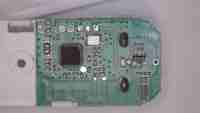

# Prucho2 — GXHTV4 PC2/PC3 (board 0x2C)

Custom Slacky-DIY Zigbee temperature and humidity firmware for a TLSR8258 PCB using a sensor marked `GV4 / 5357`, working with the **SHT4x protocol**.

## Verified hardware

| Function | MCU GPIO | Physical QFN32 pin | Details |
|---|---|---|---|
| Software I²C SDA | PC2 | 22 | Multimeter traced; tested |
| Software I²C SCL | PC3 | 23 | Multimeter traced; tested |
| Status LED | PB4 | 14 | Tested; active HIGH |
| Push button | PC0 | 20 | Tested; active LOW |
| Battery measurement | PC5 | Internal ADC | Voltage sensing |
| Sensor | GXHTV4, SHT4x-compatible | — | Temperature and humidity readings verified |
| I²C mode | **Software** | — | Same software I²C implementation as upstream Slacky-DIY |

This board has **no LCD**. The GPIO assignments, button and LED were tested on the actual PCB; the `GV4 / 5357` sensor successfully responds to the SHT40 protocol.

## Current firmware

**v7.0.04**, Zigbee OTA board/image type **0x022C**, manufacturer ID **0x6565**, firmware file version **0x70043001**.

### Development history

| Version | Notes |
|---|---|
| v7.0.02 | Initial SHT4x readout, hardware I²C |
| v7.0.03 | Added I²C reinitialization, read retry and protection against invalid reports |
| **v7.0.04** | Switched to Slacky-DIY **software I²C** on PC2/PC3; improved stability |

The latest BIN and OTA image are archived here. BIN is for SWS programming. Keep a full flash backup first.

- [Source board configuration](../../src/common/board_gxhtv4_pc2pc3.h)
- [Build workflow](../../.github/workflows/build-gxhtv4.yml)
- [Build history and artifacts](https://github.com/prucho2/ts0201_tz3000_zed/actions/workflows/build-gxhtv4.yml)

## PCB photos

